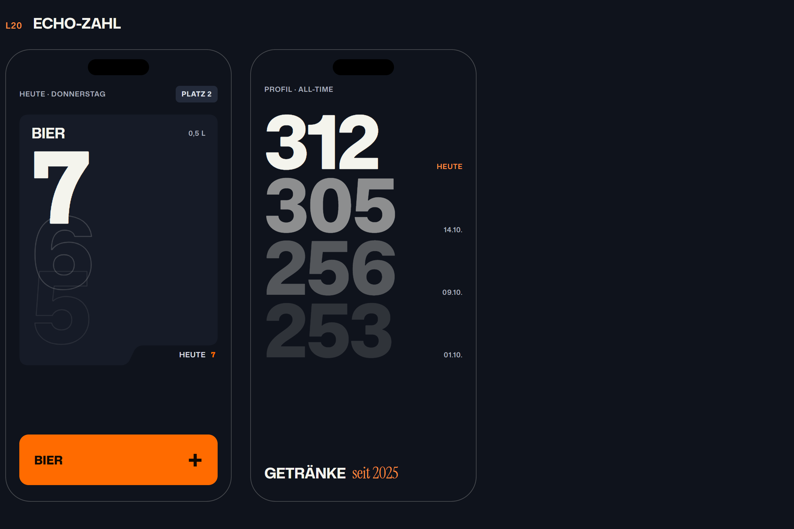
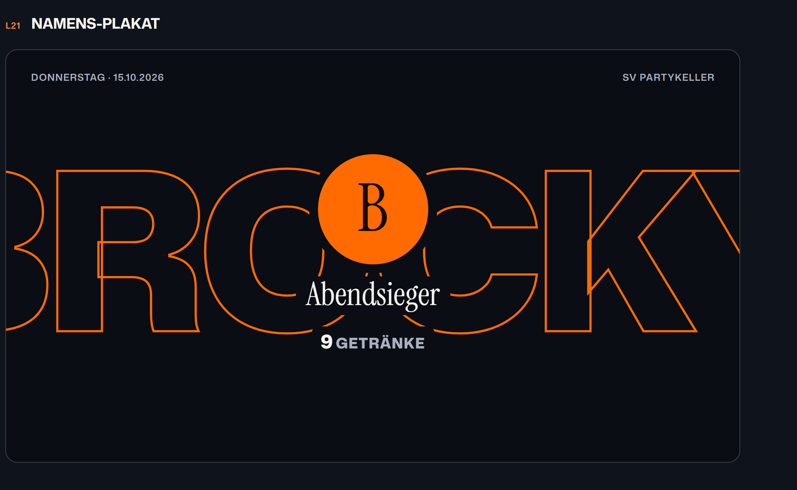
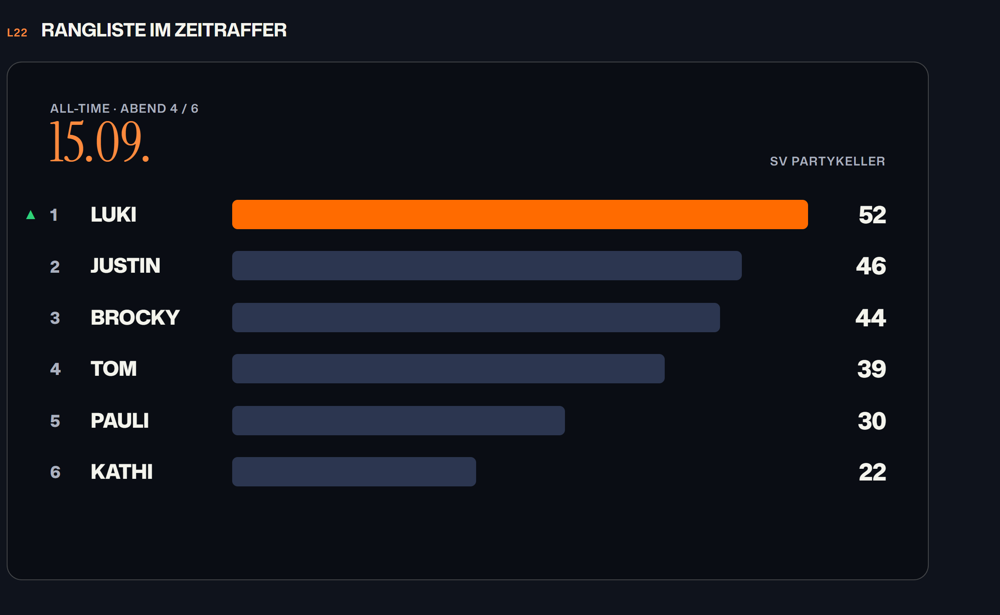
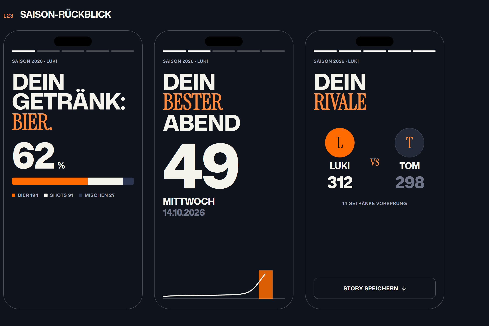
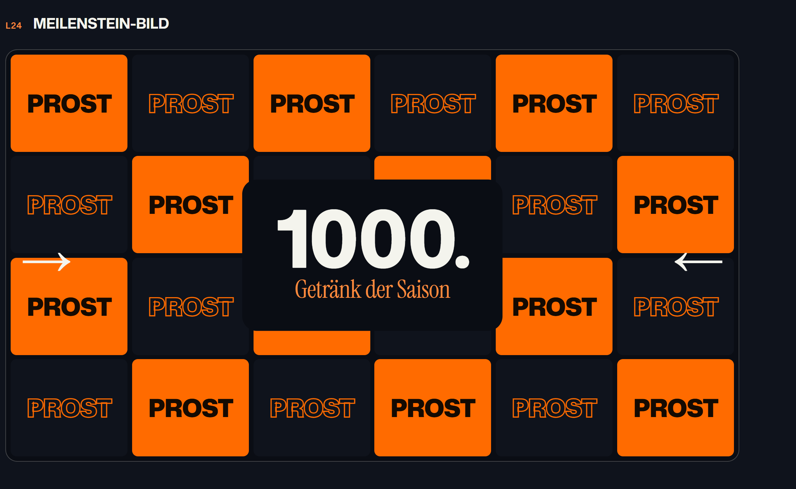
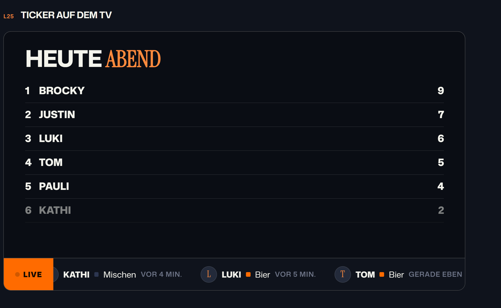
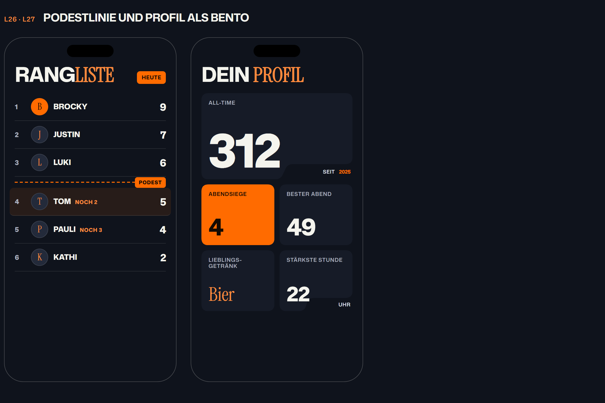

# Inspiration, Runde 3: Entwürfe L20–L29 (Stand 2026-10-15)

**Status:** L20, L21, L23 und L24 umgesetzt (D-095), der Rest sind Vorschläge. Mockups im echten Theme: [inspiration/l20-l27.html](inspiration/l20-l27.html) (mit Animationen), daraus die Bilder unten. Was schon in
[INSPIRATION-LANDO-2.md](INSPIRATION-LANDO-2.md) (L6–L19) oder in der App
steht (Podest im TV, Rivalen-Zeilen, Timing-Tower, Register im Archiv), wird
hier nicht noch einmal vorgeschlagen. Diesmal bewusst über F1 hinaus.

Quellen (angesehen am 2026-10-15):
- Dribbble-Suchen: „leaderboard dark“, „podium ranking“, „year in review
  app“, „wrapped stats“, „sports broadcast graphics“, „bento stats dark“,
  „f1 race dashboard“, darunter Nixtios
  [Formula 1 Racing Mobile App Concept](https://dribbble.com/shots/27462952-Formula-1-Racing-Mobile-App-Concept).
- Spotify Wrapped 2025: [Newsroom](https://newsroom.spotify.com/?p=37865) und
  [Rive-Fallstudie](https://rive.app/blog/spotify-used-rive-for-spotify-wrapped-2025)
  („Top Artist Sprint“).
- Duolingo-Ligen:
  [Built for Mars, „The promotion zone“](https://builtformars.com/ux-bites/leaderboards-the-promotion-zone).
- Codrops:
  [CSS-only-Karussells mit Scroll-Driven Animations](https://tympanus.net/codrops/tag/css-scroll).

Alle Ideen kommen ohne Fotos, ohne neue Abhängigkeit und ohne Internet aus.
Es gibt keine Erklärtexte (D-079).

## Gesehen und übertragen

| Muster | Herkunft | Übertragung |
|---|---|---|
| Dieselbe Zahl fünfmal gestapelt, Zeilen abwechselnd in Akzent und Umriss | Dribbble, „year in review app“ | L20 Echo-Zahl |
| Saisonwerte untereinander, ältere verblassen, der aktuelle in Gelb | Nixtio, F1-Konzept | L20 (Variante fürs Profil) |
| Spielername riesig hinter der Figur, Figur steht davor | Dribbble, Sport-Broadcast | L21 Namens-Plakat |
| „Top Artist Sprint“: Ränge Monat für Monat als Rennen | Spotify Wrapped 2025 | L22 Rangliste im Zeitraffer |
| Mehrseitiger Rückblick zum Durchtippen, je Seite eine Aussage | Wrapped, Dribbble „year in review“ | L23 Saison-Rückblick |
| Kacheln mit „GO“, Pfeile von beiden Seiten, Orange auf Schwarz | Dribbble, Sport-Broadcast | L24 Meilenstein-Bild |
| Kurzer Live-Ticker mit den letzten Ereignissen | Sport-Apps, „live activity feed“ | L25 TV-Ticker |
| Aufstiegszone: Linie in der Tabelle, „noch 2 bis …“ | Duolingo-Ligen | L26 Podestlinie |
| Kacheln unterschiedlicher Größe statt gleichförmigem Raster | „bento“-Layouts | L27 Profil als Bento |

Weggelassen: Glas-Effekte und Neon-Glow (passen nicht zu Lando, kein
`backdrop-filter`), 3D-Podeste mit Leuchtkanten (TV hat schon ein Podest),
Fitness-Ringe um die Getränkezahl (würden mehr Trinken als Ziel
darstellen).

---

## L20 – Echo-Zahl beim Tippen

Beim +1 auf der Zählseite rutscht die alte Zahl als Umriss-Kopie nach unten
weg und verblasst. Bei schnellem Tippen entsteht kurz ein Stapel aus zwei,
drei Echos. Die neue Zahl steht sofort fest, das Echo ist rein dekorativ
(`pointer-events: none`) und beim Tippen nie im Weg. Die Profil-Variante
zeigt die All-Time-Zahl mit den Werten der letzten Abende darunter, jede
Zeile etwas blasser. Mit „Bewegung reduzieren“ entfällt das Echo.

## L21 – Namens-Plakat für den Abendsieger

Am Ende des Abends (oder wenn der Admin „Auf den TV“ wählt) füllt der Name
des Siegers als Umrissschrift die ganze Breite. Davor steht der
Initialen-Kreis mit Lorbeer, darunter in der Serif „Abendsieger“ und die
Zahl. Der Name läuft einmal langsam seitlich durch. Ohne Foto kommt es auf
die Typografie an, und die trägt das Bild.

## L22 – Rangliste im Zeitraffer

Im Archiv und als TV-Pausenbild: Die All-Time-Rangliste baut sich Abend für
Abend auf, Balken wachsen, Plätze tauschen mit Bewegung, oben läuft das Datum
mit. Am Ende hält das Bild bei „heute“. **Aufwand:** Der Server liefert pro
Abend bisher nur Sieger und Summen. Gebraucht werden die Summen pro Person und
Abend; das wäre ein neuer Endpunkt (aus den Getränken berechenbar, kein neues
Schema).

## L23 – Saison-Rückblick zum Durchtippen

Für die eigene Person, zum Saisonende (die Saisonlogik in `js/season.js` gibt es schon): fünf
bis sechs Seiten im Story-Format, Tippen rechts = weiter, links = zurück,
Fortschrittsstriche oben. Je Seite genau eine Aussage, zum Beispiel
Lieblingsgetränk, bester Abend, stärkste Stunde, Rivale, Abzeichen. Die
letzte Seite lässt sich über das vorhandene `story.js` als Bild speichern.

## L24 – Meilenstein-Bild auf dem TV

Beim Hausrekord, beim 1000. Getränk der Saison o. Ä. kippt der TV für etwa
drei Sekunden in ein Kachelraster: „PROST“ in Orange auf Schwarz, Kacheln
klappen nacheinander um, zwei Pfeile fahren von außen ein. Danach geht es
zurück zur Rangliste. Ergänzt L16 (Kritzel bei Rekorden), ersetzt es nicht.

## L25 – Ticker auf dem TV

Unten am TV läuft eine schmale Leiste mit den letzten drei bis fünf
Getränken: Initiale, Name, Farbquadrat der Getränkeart, „gerade eben / vor
2 Min.“. Neue Einträge schieben sich von rechts herein. Die Daten sind schon
da (`lastDrinkTs` im State); für mehr als ein Ereignis pro Person bräuchte
der State eine kurze Liste der letzten Getränke.

## L26 – Podestlinie in der Rangliste „Heute“

Zwischen Platz 3 und 4 eine gestrichelte Linie in Akzentfarbe mit dem
Etikett „Podest“. Wer auf 4 oder 5 steht, sieht in seiner Zeile „noch 2“.
Die Rivalen-Zeilen im Dashboard zeigen den Abstand zum Vordermann schon;
das hier macht die Schwelle zum Podest für alle sichtbar, auch auf dem TV.

## L27 – Profil als Bento-Raster
Alternative zu L6: statt dreier gleich großer Kennzahlen ein Raster mit
einer großen Kachel (All-Time) und kleineren (Abendsiege, bester Abend,
Lieblingsgetränk, Lieblingsstunde). Kacheln als Kerbenkarten, auf dem Handy
zwei Spalten. Passt, wenn L6 zu laut wirkt.

---

## Technische Optimierungen

### L28 – Weniger JS für Einblendungen
`@starting-style` und `animation-timeline: view()` können einfache
Einblendungen (`data-reveal="up"`, `"fade"`) ohne IntersectionObserver
übernehmen. JS bleibt als Rückfall für Browser ohne Unterstützung (Firefox
hat `animation-timeline` noch nicht durchgehend). Gewinn: weniger Arbeit beim
Laden auf alten Handys und auf dem Pi-Browser.

### L29 – `content-visibility: auto` für lange Listen
Für Admin-Protokoll und lange Ranglisten: Zeilen außerhalb des Bildes werden
nicht gerendert. Ein Einzeiler mit `contain-intrinsic-size`, ohne
Verhaltensänderung.

### Bewusst nicht vorgeschlagen
- **Bildschirm-Wachhalten (Wake Lock) für den TV** und **Teilen der Story
  direkt an Instagram (Web Share)**: Beide gehen nur in einem sicheren
  Kontext (HTTPS oder localhost). Die App läuft per HTTP im WLAN; auf dem
  Handy und am TV wären sie also nicht verfügbar.
- **Rückgängig für den letzten Tipp**: würde D-004 (Nutzer nur +1) brechen
  und braucht erst eine eigene Entscheidung.

## Vorschlag zur Reihenfolge
1. L26 Podestlinie und L20 Echo-Zahl: klein, sofort spürbar.
2. L25 Ticker und L21 Namens-Plakat: machen den TV lebendiger.
3. L22 und L23: die größten Effekte, brauchen aber Serverarbeit.
4. L28/L29 nebenbei, wenn ohnehin an den Seiten gearbeitet wird.
