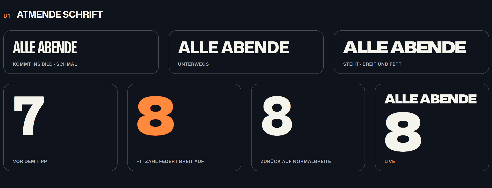
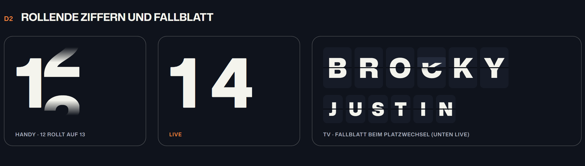
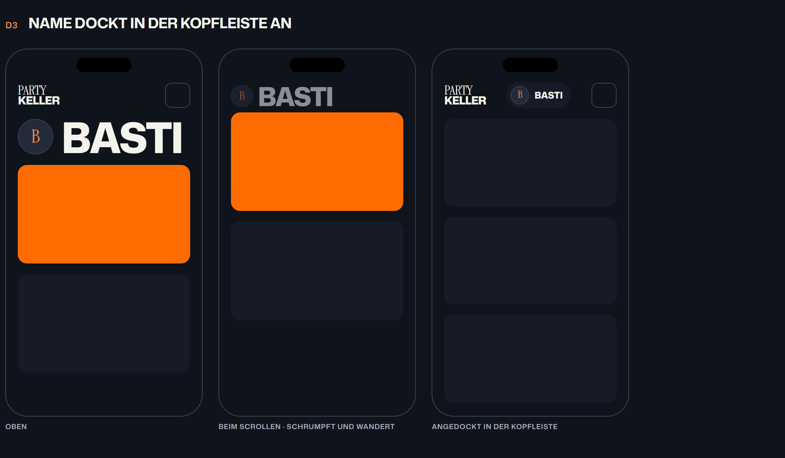
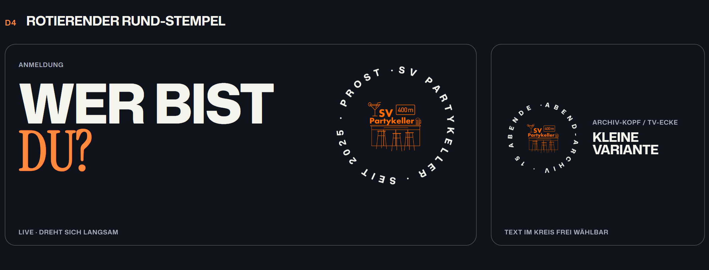
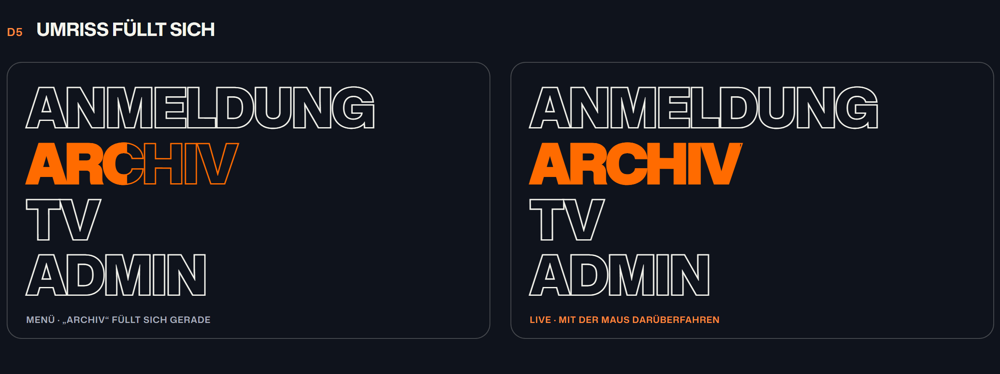
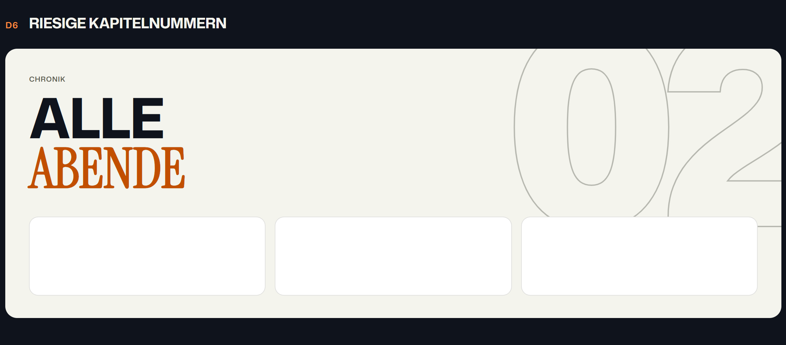
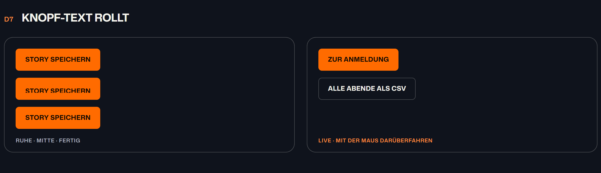
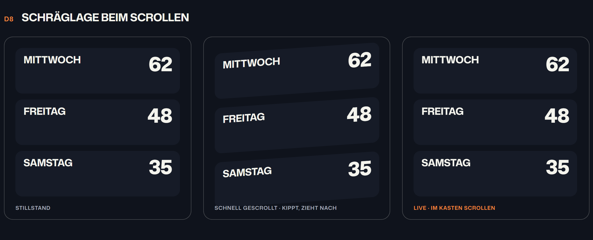
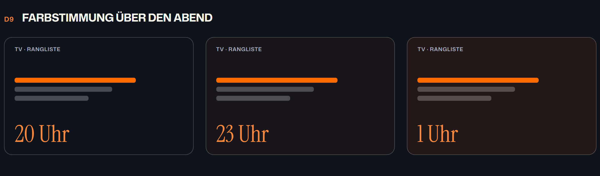

# Design-Ideen D1–D9 (Stand 2026-10-15)

**Status:** D3 umgesetzt (D-097), der Rest sind Vorschläge. Reine Optik (Typografie,
Formen, Bewegung), keine neuen Funktionen. Mockups im echten Theme mit
Animationen: [inspiration/d1-d9.html](inspiration/d1-d9.html), daraus die
Bilder unten. Im Code geprüft: keine dieser Techniken gibt es in der App schon.

Alle Ideen bleiben ohne neue Abhängigkeit und ohne Internet, sind bei
„Bewegung reduzieren" aus und kommen ohne Erklärtexte aus (D-079).

## D1 – Atmende Schrift
Mona Sans ist variabel (Breite 75–125 %, Gewicht 200–900). Überschriften
kommen beim Scrollen schmal herein und ziehen sich auf volle Breite auf; die
Getränkezahl federt bei +1 kurz breit auf.

## D2 – Rollende Ziffern und Fallblatt
Zahlen rollen wie ein Zählwerk (Handy); auf dem TV wechseln Namen beim
Platztausch wie eine Fallblatt-Anzeige. Entspricht L17.

## D3 – Name dockt in der Kopfleiste an
Der große Name im Dashboard schrumpft beim Scrollen und landet als kleine
Pille mit Initiale in der Kopfleiste.

## D4 – Rotierender Rund-Stempel
Text im Kreis (SVG `textPath`) um das Logo, dreht sich langsam. Groß auf der
Anmeldung, klein im Archiv-Kopf oder in der TV-Ecke; der Text ist frei wählbar.

## D5 – Umriss füllt sich
Menülinks als Umriss, beim Darüberfahren läuft die Akzentfarbe von links
hinein. Hinweis zur Umsetzung: Mona Sans hat überlappende Konturen, ein reiner
`-webkit-text-stroke` zeigt innere Linien (E, G, H). Sauber wird es mit
Füllung in Grundfarbe und `paint-order: stroke fill`, darüber eine
deckungsgleiche Akzent-Kopie mit `clip-path`.

## D6 – Riesige Kapitelnummern
„01", „02" als blasse Umriss-Zahlen hinter den Abschnitten, am Rand
angeschnitten.

## D7 – Knopf-Text rollt
Beim Darüberfahren rollt die Beschriftung nach oben weg, dieselbe Zeile kommt
von unten nach.

## D8 – Schräglage beim Scrollen
Karten kippen bei schnellem Scrollen leicht (höchstens 6°) und richten sich
beim Stehenbleiben wieder auf.

## D9 – Farbstimmung über den Abend
Der Grund wandert im Lauf des Abends leicht von kühlem Navy zu einem wärmeren
Ton (über `color-mix`, nur der Grund, Akzent und Schrift bleiben).

